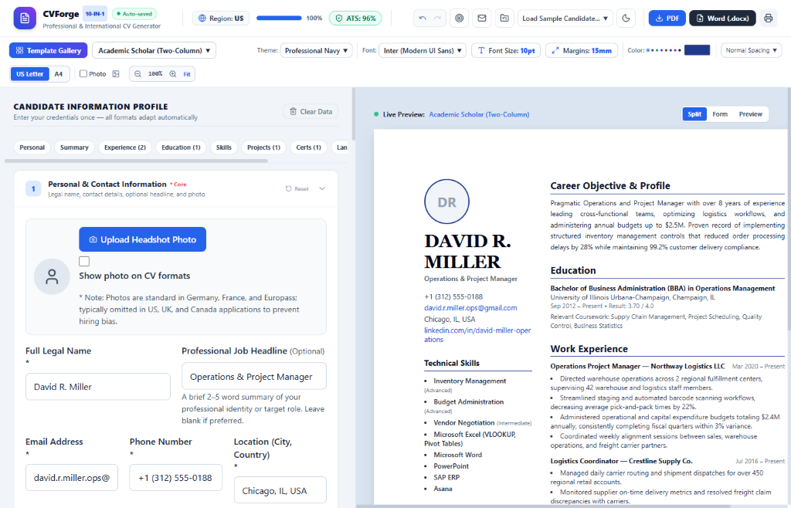
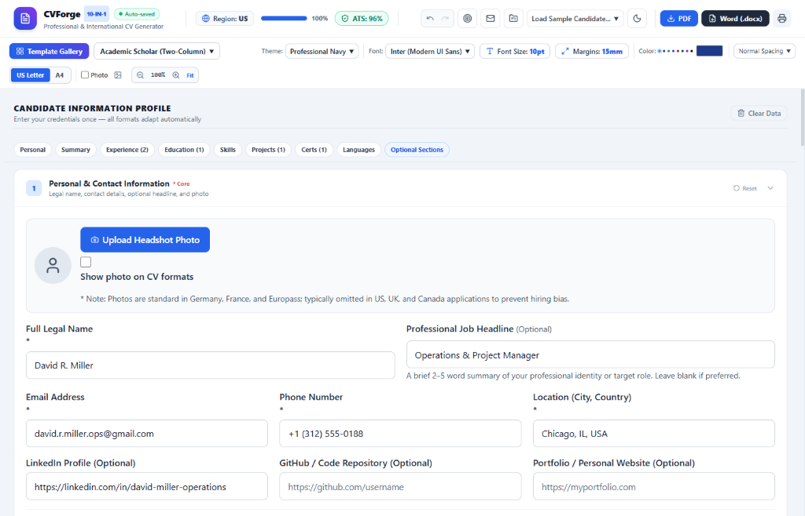
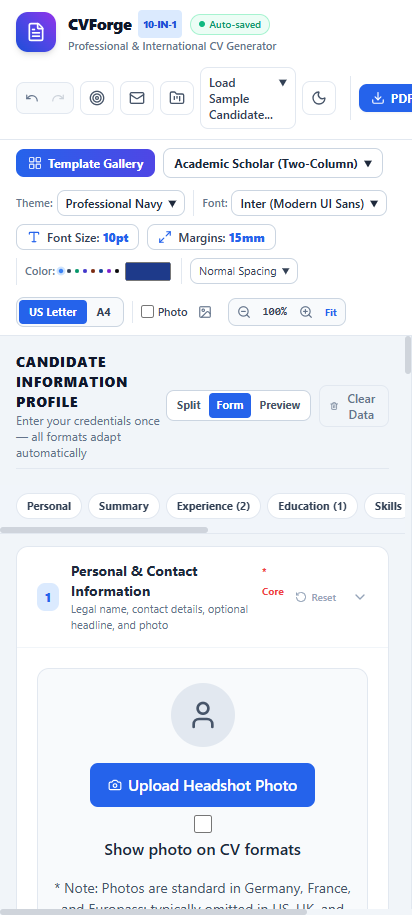
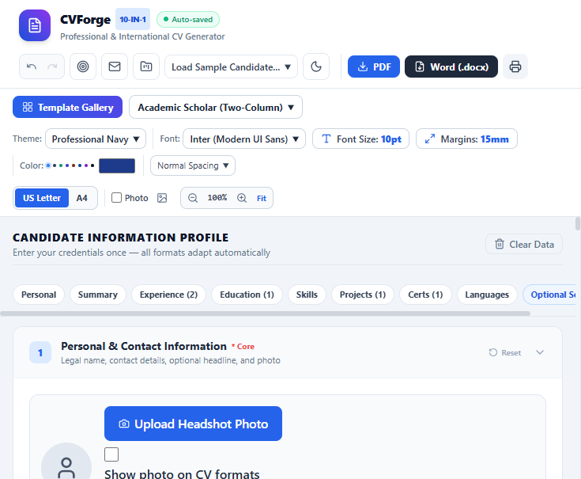

<div align="center">

# 📄 CVForge

### 10-in-1 Professional CV & Resume Generator

**Modern, privacy-first, browser-based CV builder delivering recruiter-ready, ATS-compliant resumes and curriculum vitae.**

[](https://sobuj-here.github.io/CVForge/)
[](LICENSE)
[](https://sobuj-here.github.io/CVForge/)
[](https://sobuj-here.github.io/CVForge/)
[](https://sobuj-here.github.io/CVForge/)

</div>

---

## 🌐 Live Website

> ### 👉 [Open CVForge — Create Your CV Online](https://sobuj-here.github.io/CVForge/)
>
> **No app installation or software downloads required.** CVForge runs directly in any modern web browser across **Android phones, iPhones, tablets, laptops, and desktop computers** (Google Chrome, Apple Safari, Microsoft Edge, Mozilla Firefox, Brave, and Opera). 
> 
> Simply open the link above to immediately start crafting your professional resume or CV with real-time live preview.

---

## 📸 Screenshots

<div align="center">

### Desktop Split-Screen Workspace (Form Editor + Live Canvas)


### Interactive Template Gallery (10 Formats & 50+ Curated Templates)


| Mobile Browser View (Android Chrome) | Candidate Information Form Editor |
| :---: | :---: |
|  |  |

</div>

---

## 🌟 Core Features

### 1. 10 Genuinely Distinct CV Formats
CVForge does not merely swap colors or change fonts. Every format implements an authentic, internationally recognized structure tailored for specific industries, seniorities, and geographic regions:

| # | Format Category | Best For | Distinctive Characteristics |
| :---: | :--- | :--- | :--- |
| **1** | **Reverse Chronological** | Corporate, Mid-Senior, Management | Standard corporate format; highlights recent achievements, promotions, and metrics first. |
| **2** | **Functional CV** | Career changers, employment gaps | Organizes around core transferable competency clusters; compact work chronology. |
| **3** | **Chronological CV** | Traditional industries, tenure stability | Forward progression story highlighting foundational beginnings and sustained growth. |
| **4** | **Skills-Based CV** | Freelancers, specialists, contractors | Built around verified proficiency matrices (Expert, Advanced, Proficient) and project proof. |
| **5** | **Combination / Hybrid** | Multi-disciplinary leaders, technical PMs | Executive competency grid at the top with full chronological work history below. |
| **6** | **Targeted CV** | Specific job openings | Target Position Header, tailored Value Proposition, and Requirement-to-Qualification match grid. |
| **7** | **Academic CV (Scholarly)** | Professors, researchers, PhD candidates | Multi-page dossier with research interests, dissertation advisor, peer-reviewed publications, DOI links, and grants. |
| **8** | **Europass CV** | European Union job applications | Official EU structure with CEFR language passport (A1–C2 grid), mother tongue, and digital competences. |
| **9** | **ATS-Friendly CV** | High-volume online job boards | Machine-readable single column, standard semantic hierarchy, universal fonts, zero floating elements. |
| **10** | **Creative / Visual CV** | UI/UX designers, marketing, creatives | Designer-forward split layout with optional avatar, visual skill meters, and showcase cards. |

### 2. Separate Template Galleries & 50+ Unique Templates
- **Dedicated Galleries**: Each of the 10 formats features its own curated collection of 5 distinct templates (50 unique designs total).
- **Professional Custom Templates**:
  - *Corporate Executive Banner*: High-impact header banner with balanced two-column body layout.
  - *Academic Scholar (Two-Column)*: Elegant left-hand academic sidebar with detailed right-hand scholarly output.
  - *Institutional Classic CV*: Clean bordered academic format with publication indexes and formal referee tables.
- **Dynamic Theming**: 7 professional color themes (*Professional Navy*, *Minimal White*, *Soft Blue*, *Soft Lavender*, *Warm Beige*, *Light Gray*, and *Modern Pastel*) with full Light and Dark mode support.

### 3. Genuine Editable Microsoft Word (.docx) Export
- Unlike conventional resume tools that embed flattened images or convert PDFs into uneditable shapes, CVForge generates **genuine native OpenXML `.docx` files**.
- Every heading, job title, company name, bullet point, and referee entry remains individually editable as native Microsoft Word text and tables.
- Preserves template structure, multi-column tables, borders, and typography formatting.

### 4. Recruiter-Ready PDF & Print Engine
- High-DPI vector PDF rendering powered by client-side document generators.
- Built-in pagination engine with automatic page break avoidance.
- Dedicated browser Print CSS (`@media print`) matching physical Letter and A4 dimensions.

### 5. Typography & Margin Controls
- **22 Professional Font Families**: Choose from Inter, Roboto, Lato, Open Sans, Montserrat, Poppins, IBM Plex Sans, Merriweather, Playfair Display, and more.
- **Point-Based Sizing (`pt`)**: Industry-standard document typography controls with adjustable base sizes (9pt to 12pt).
- **Customizable Page Margins**: Fine-tune margins from Compact (5mm) to Generous (25mm) for precise single-page or multi-page packing.

### 6. Country-Specific Conventions
Adapt your CV to local hiring standards with one click:
- **United States & Canada**: Strict anti-discrimination compliance (omits photo, date of birth, marital status, nationality).
- **United Kingdom**: British terminology, optional driving licence, professional summary standards.
- **Germany & DACH (Lebenslauf)**: Formal profile structure, optional professional portrait, structured language proficiencies.
- **European Union**: Full Europass compliance and CEFR language framework.
- **Bangladesh & South Asia**: Optional father's/mother's name, permanent address, and national identity disclosures.

### 7. Form Clarity & Clean Default State
- **Clean Blank Starting Profile**: CVForge starts with a blank slate (`isDemo: false`). No fake names (e.g. Sarah Miller) or placeholder records are ever pre-filled into your documents.
- **Optional Professional Headline**: Add a headline when applicable, or leave it blank without leaving gaps or errors.
- **Smart References**: The outdated *"References available upon request"* phrase is completely removed. The references section only appears when actual referee contact details are entered.
- **Natural English UI**: 100% professional English UI with clear instructions, helpful placeholders, and real-world examples.

### 8. Intelligent Career Tools
- **Rule-Based ATS Auditor**: Analyzes keyword density, contact completeness, bullet point structure, and format compliance.
- **Job Keyword Matcher**: Compare your CV against any target job description to identify missing skill keywords.
- **Matching Cover Letter Generator**: Produce an aligned, matching cover letter in seconds.
- **Photo Cropper**: Client-side canvas photo cropper with zoom (1x–3x), panning, circular/square masks, and instant preview.

### 9. 100% Client-Side Privacy
- **Zero Server Tracking**: All candidate information is stored exclusively in your browser's `localStorage`.
- **Zero Data Uploads**: Your personal information, employment history, and exported files never touch an external server.
- **One-Click Data Wipe**: Clear all stored data or export encrypted JSON backups whenever you want.

---

## 🚀 Getting Started

### Using the Live Website
Simply visit **[https://sobuj-here.github.io/CVForge/](https://sobuj-here.github.io/CVForge/)** in any modern desktop or mobile browser. Everything is ready immediately—no accounts, no subscriptions, no installations.

### Running Locally (For Developers)

#### Option 1: Direct Browser Access
Because CVForge uses an automated self-contained bundle `assets/js/bundle.js`, you can run it completely offline:
1. Clone the repository:
   ```bash
   git clone https://github.com/sobuj-here/CVForge.git
   cd CVForge
   ```
2. Double-click `index.html` to open it in your default web browser (`file:///...`), or open with Live Server in VS Code.

#### Option 2: Python HTTP Server
```bash
# Clone the repository
git clone https://github.com/sobuj-here/CVForge.git
cd CVForge

# Start local HTTP server
python server.py
# or: py server.py
```
Open **`http://localhost:8080`** in your browser.

#### Rebuilding the JS Bundle (Optional)
If you modify source modules in `assets/js/`:
```bash
node scripts/create_bundle.js
```

---

## 🛠️ Technology Stack & Architecture

```
CVForge/
├── index.html                           # Single-page web application entry point
├── server.py                            # Lightweight development HTTP server
├── manifest.json                        # Web application manifest
├── LICENSE                              # MIT License
├── README.md                            # Comprehensive project documentation
├── .github/
│   └── workflows/
│       └── deploy.yml                   # Automated test validation & GitHub Pages deployment
├── screenshots/                         # Actual application interface screenshots
│   ├── cvforge-desktop-split.png        # Desktop split-screen view
│   ├── cvforge-mobile-view.png          # Mobile responsive view (Android Chrome)
│   ├── cvforge-template-gallery.png     # Interactive template gallery modal
│   └── cvforge-form-editor.png          # Candidate profile form editor
├── scripts/
│   ├── create_bundle.js                 # Unified ES module bundler for offline/web execution
│   └── verify_project.py                # Fast local sanity check script
├── tests/
│   ├── check_js_syntax.py               # Node.js syntax checker for all 52 modules
│   ├── verify.py                        # Core application verification suite
│   ├── test_10_formats_and_templates.py # Audit for all 10 formats & 50 templates
│   ├── test_docx_editing.py             # OpenXML structure & Word editability validator
│   └── test_complete_professional_upgrade.py # International rules & UI compliance test
└── assets/
    ├── favicon.svg                      # Vector favicon
    ├── css/
    │   ├── styles.css                   # Master layout, responsive columns, and modal styles
    │   └── templates.css                # Typography & layout rules for all 10 formats
    ├── icons/                           # High-resolution web icons (192px, 512px, SVG)
    └── js/
        ├── app.js                       # Application entry point & modal coordinator
        ├── bundle.js                    # Self-contained bundled application script
        ├── vendor/                      # Offline client-side libraries
        │   ├── docx.min.js              # Native Word (.docx) OpenXML document builder
        │   ├── html2pdf.bundle.min.js   # Client-side high-DPI PDF generator
        │   ├── lucide.min.js            # Clean icon system
        │   └── tailwind.min.js          # Tailwind CSS styling engine
        ├── models/
        │   ├── state.js                 # Reactive state manager with undo/redo history
        │   └── sampleData.js            # Realistic sample profiles for demonstration
        ├── engine/
        │   ├── atsEngine.js             # Rule-based ATS heuristic auditor
        │   ├── countryRules.js          # Regional hiring conventions (US, UK, DE, FR, EU, etc.)
        │   ├── keywordMatcher.js        # Job description keyword comparison engine
        │   ├── summaryEngine.js         # Professional profile summary generator
        │   └── completeness.js          # Profile completeness percentage calculator
        ├── templates/
        │   ├── index.js                 # Template registry & format dispatcher
        │   ├── catalog.js               # Metadata catalog for all 50+ templates
        │   ├── templateUtils.js         # Shared layout helpers & sanitizers
        │   ├── reverseChrono.js         # Format 1: Reverse Chronological
        │   ├── functional.js            # Format 2: Functional
        │   ├── chronological.js         # Format 3: Chronological
        │   ├── skillsBased.js           # Format 4: Skills-Based
        │   ├── combination.js           # Format 5: Combination / Hybrid
        │   ├── targeted.js              # Format 6: Targeted
        │   ├── academic.js              # Format 7: Academic Scholarly
        │   ├── europass.js              # Format 8: Europass EU
        │   ├── atsFriendly.js           # Format 9: ATS-Friendly
        │   ├── creativeVisual.js        # Format 10: Creative Visual
        │   ├── corporateExecutive.js    # Corporate Executive templates
        │   └── extendedTemplates.js     # Extended template variations
        ├── export/
        │   ├── docxExporter.js          # Native OpenXML Word (.docx) export engine
        │   ├── pdfExporter.js           # Vector PDF & print stylesheet controller
        │   └── jsonExporter.js          # Encrypted JSON profile backup & restore
        └── components/
            ├── formSections.js          # 16 interactive profile form accordions
            ├── customizeBar.js          # Customization toolbar (theme, font, spacing, view)
            ├── templateGalleryModal.js  # 2-step visual template selection gallery
            ├── typographyModal.js       # Precise font family & point size modal
            ├── marginsModal.js          # Page margin adjustment controls (5mm–25mm)
            ├── exportModal.js           # Pre-export verification and download dialog
            ├── photoCropModal.js        # Canvas photo cropper with zoom & pan
            ├── jobMatcherModal.js       # Keyword comparison assistant
            ├── countryModal.js          # Country hiring rules selector
            ├── coverLetter.js           # Matching cover letter generator
            ├── profileManagerModal.js   # Multi-profile switcher & JSON storage
            └── clearDataModal.js        # Safe data wipe confirmation modal
```

---

## 🔒 Privacy & Data Sovereignty

Your resume contains some of your most sensitive personal information: home address, phone number, employment history, and academic records.

- **100% Private**: CVForge does not use remote databases, analytics trackers, or user profiling.
- **Client-Side Only**: All document rendering (PDF and DOCX) occurs inside your browser using JavaScript and HTML Canvas.
- **Offline Capable**: After the initial web page load, CVForge functions completely without internet access.

---

## 📄 License & Contribution Guidelines

This project is licensed under the **MIT License** — see the [LICENSE](LICENSE) file for details.

### Contributing
Contributions are warmly welcomed! To contribute:
1. Fork the repository.
2. Create a feature branch: `git checkout -b feature/new-template`
3. Commit your changes: `git commit -m "Add new executive template"`
4. Push to your branch: `git push origin feature/new-template`
5. Open a Pull Request.

---

## 💬 Support & Contact

- **Author**: SOBUJ
- **GitHub Profile**: [@sobuj-here](https://github.com/sobuj-here)
- **Project Issues**: [Report a bug or request a feature](https://github.com/sobuj-here/CVForge/issues)
- **Live Website**: [https://sobuj-here.github.io/CVForge/](https://sobuj-here.github.io/CVForge/)
